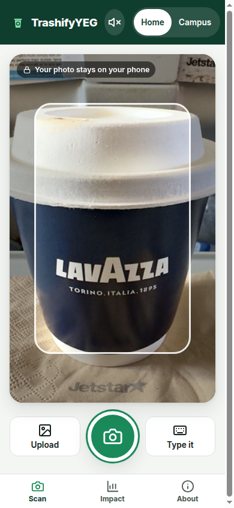
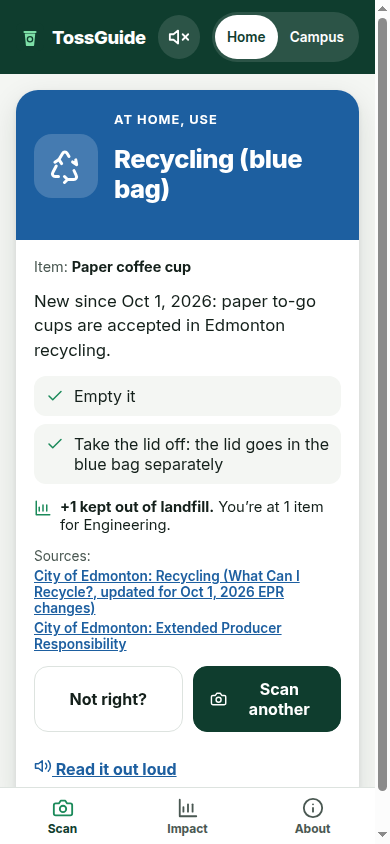
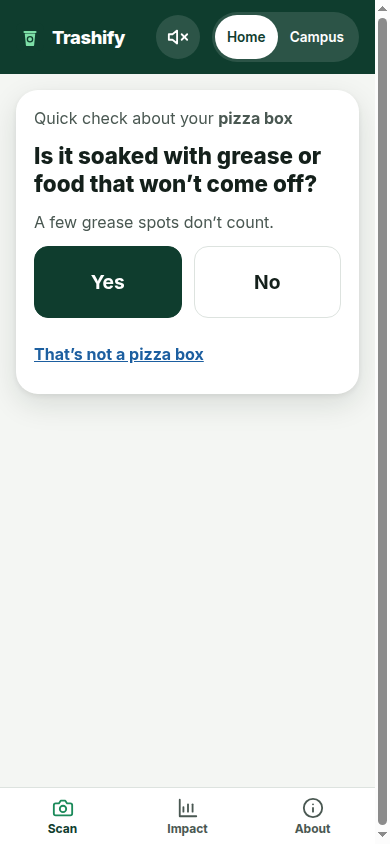
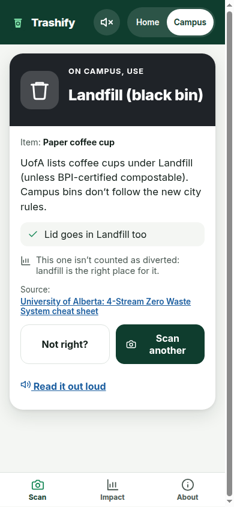
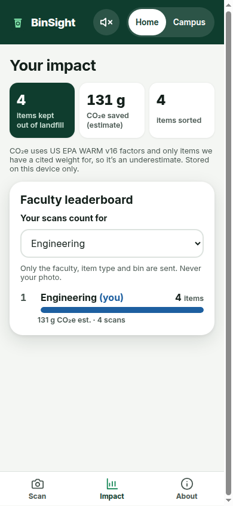

# BinSight

**Point. Sort. Done.** Point your phone at an item and BinSight tells you exactly which **City of Edmonton** or **University of Alberta** bin it goes in, and why, citing the official source.

Built in 24 hours at **HackEd Beta 2026** (University of Alberta) by Aditya & Sanika.

<p>
  
  
  
  
  
</p>

## Why it's different

- **Hyper-local, current rules.** On **Oct 1, 2026**, Edmonton's residential recycling list expanded under Alberta's Extended Producer Responsibility rules: coffee cups, chip bags, candy wrappers and foam now go in the **blue bag**. Most guides (and chatbots) still say "garbage". UofA campus bins follow different, institutional rules, and the **Home/Campus** toggle shows both. Every answer links to its source.
- **Asks instead of guessing.** For items whose bin depends on their condition, it asks one quick question ("Is it soaked with grease?"). If the model isn't sure, or its top two guesses go in different bins, it shows a one-tap picker. Items the City doesn't clearly cover say **"Check before you toss"**.
- **On-device and private.** A zero-shot CLIP model runs in your browser: no training, no cloud, and **your photo never leaves your phone**. It works offline after the first visit.
- **Measured, not claimed.** An evaluation harness reports item and bin accuracy, a confusion matrix and a threshold sweep. The threshold comes from that data.
- **Impact you can see.** A personal tally of items kept out of landfill, a cited CO₂e estimate, and a live faculty leaderboard that starts empty.

## How it works

```
 camera / upload ──► on-device CLIP (Web Worker) ──► decision logic ──► Edmonton/UofA rules engine ──► result
                     image embedding vs 120          answer, or ask     cited rule tree per item         bin, reason,
                     precomputed text prompts        (top-3 picker)     + yes/no follow-up questions     prep, source
 type it ───────────────────────────────────────────► fuzzy lookup ─────┘
```

1. **Vision** (`client/src/ml/classifier.worker.ts`): the CLIP ViT-B/32 vision encoder (int8, ~89 MB) runs in a Web Worker on ONNX Runtime WASM. The **text embeddings for our 120 prompts are precomputed** (`npm run embed`), so phones download only the vision half.
2. **Scoring** (`shared/src/ml/classify-core.ts`, `aggregate.ts`): cosine similarity × CLIP's logit scale; prompts are combined per item (logsumexp, chosen by the eval) and softmaxed into calibrated scores.
3. **Decision** (`shared/src/ml/decide.ts`): answer only if the top score ≥ the tuned threshold **and** the top two items can end up in the same bins. Otherwise show the top 3.
4. **Rules** (`shared/src/rules/`): 44 items × 2 contexts, hand-written from the City of Edmonton and UofA pages. Each rule is a small tree with optional yes/no questions; every leaf cites a source. `resolve(itemId, context, answers)` never throws.
5. **Impact** (`shared/src/impact/impact.ts`): US EPA WARM v16 factors × cited item weights. Landfill and "check first" never count as diverted.
6. **Server** (`server/`): a tiny Express API for the leaderboard (zod validation, per-IP rate limit, crash-safe JSON storage). CO₂e is computed server-side, and a scan whose bin the rules can't produce for that item is rejected. The app works fully without it.
7. **Offline** (`client/src/sw.js`, `client/build/offline-plugin.ts`): a hand-written service worker precaches the app and the self-hosted ONNX runtime; Transformers.js caches the model.

## Measured accuracy

From `npm run eval` ([eval/REPORT.md](eval/REPORT.md)). **These numbers are from a development set of 93 freely licensed object photos (25 items) from Wikimedia Commons, not from venue photos.** See [eval/README.md](eval/README.md) for how the set was built and its caveats.

| Metric | Value |
|---|---|
| Right **bin** from the top guess | **89.2%** |
| Right item, top guess / in top 3 | 82.8% / 92.5% |
| Answered directly (threshold 0.6) | 37.6% of photos, **97.1% right bin** |
| Asked to confirm | 62.4% of photos; the right item is in the picker 91.4% of the time |
| Median latency (laptop CPU, Node) | 91 ms per photo |

In a real Chromium browser on a laptop, the model loaded in ~8 s on first visit (3.5 s from cache) and a scan took about 0.7 s.

## Tests

- **244 unit and integration tests** (Vitest): rules engine (every item × context), decision logic, aggregation, impact, server routes, client tally, API client, image EXIF handling.
- **Blind holdout suite** (`tests/blind/`): written by a separate agent that saw only the spec and the cited rules, never the implementation. No blind test was edited to pass.
- **37 end-to-end tests** (Playwright, headed, mobile + desktop): fake-camera scan, upload, type-it, follow-ups, picker, campus toggle, tally and leaderboard, backend down, offline reload, camera denied, keyboard-only, axe accessibility on every screen, layout, visual regression, and 4 tests with the real model.

## Run it

Requires Node 22+.

```bash
npm install
npm run dev            # app on http://localhost:5173, leaderboard API on :8787
npm test               # unit + blind tests
npm run test:e2e       # Playwright, headed (use xvfb-run on a server, or HEADLESS=1)
npm run eval -- --dir eval/images --label "venue eval set"   # accuracy report on your photos
npm run build && npm start   # production build + API on one port (http://localhost:8787)
```

- **No API keys or `.env` needed.** Optional: `PORT` (default 8787) and `DATA_FILE` (leaderboard JSON, default `server/data/scans.json`). See `.env.example`.
- **Phone testing:** the camera needs HTTPS (or localhost). Use a tunnel such as `npx cloudflared tunnel --url http://localhost:8787` after `npm run build && npm start`, or deploy. Upload and type-it work without a camera.
- **One-command deploy** (Linux server with tmux and [cloudflared](https://github.com/cloudflare/cloudflared/releases)): `scripts/deploy.sh` pulls `main`, makes a production build, frees port 8080, starts the server in tmux and opens a Cloudflare HTTPS tunnel (the phone camera needs HTTPS), then prints the link. Re-run it after every merge; `--new-tunnel` gets a fresh link.
- **Vercel:** import the GitHub repo (Framework preset: Other; `vercel.json` sets the build). `scripts/vercel-build.mjs` writes the static app plus one serverless function for `/api/*`. For a leaderboard that persists, add **Upstash Redis** (Vercel → Storage → Upstash for Redis → connect to the project), which sets `KV_REST_API_URL` and `KV_REST_API_TOKEN`, then redeploy. Without it the app still works, but the leaderboard lives in `/tmp` and can reset.
- **Deploying (other options):** the ML runs in the browser, so no GPU server is needed. The simplest setup is one small VM running `npm run build && npm start` behind HTTPS (Caddy/nginx), with `DATA_FILE` on a persistent disk. Static hosts (e.g. Vercel) can serve `client/dist`, but the leaderboard needs a server with a persistent file system.

## Data sources

- City of Edmonton: [Recycling](https://www.edmonton.ca/programs_services/garbage_waste/recycling), [Food Scraps](https://www.edmonton.ca/programs_services/garbage_waste/food-scraps), [Curbside Collection](https://www.edmonton.ca/programs_services/garbage_waste/curbside-cart-collection), [Eco Stations](https://www.edmonton.ca/programs_services/garbage_waste/eco-station-acceptable-items), [Extended Producer Responsibility](https://www.edmonton.ca/programs_services/garbage_waste/extended-producer-responsibility)
- Alberta Beverage Container Management Board: [deposit refunds](https://www.bcmb.ab.ca/depot-owners-operators/depot-compliance/)
- University of Alberta: [4-Stream Zero Waste cheat sheet](https://www.ualberta.ca/en/campus-operations-services/media-library/documents/waste-system-cheat-sheet-2021.pdf), [How to Recycle](https://www.ualberta.ca/en/campus-operations-services/buildings-grounds/recycling/how-to-recycle.html)
- US EPA [WARM v16](https://www.epa.gov/waste-reduction-model) emission factors
- Full research notes and the generated rules table: [docs/RESEARCH.md](docs/RESEARCH.md)

## Credits and licences

- Model: [OpenAI CLIP ViT-B/32](https://github.com/openai/CLIP) (MIT licence), ONNX conversion [Xenova/clip-vit-base-patch32](https://huggingface.co/Xenova/clip-vit-base-patch32), run with [Transformers.js](https://github.com/huggingface/transformers.js) (Apache-2.0) and ONNX Runtime Web (MIT).
- Font: Inter (SIL OFL) via Fontsource.
- Photos in `eval/dev-commons/` and `tests/fixtures/`: Wikimedia Commons, credited individually in their `CREDITS.md` files.

## Privacy

Photos are processed on the device and never uploaded or stored. The leaderboard receives only `{ faculty, itemId, destination, divertedFromLandfill }`; the server stores those plus a timestamp, never IP addresses. The personal tally lives in your browser's local storage.

## Honest limitations

- Accuracy numbers come from web photos, not the venue. Re-run `npm run eval` on venue photos (`eval/images/`).
- Most photos get a one-tap confirmation because of the "top two must agree on the bin" safety rule.
- Only the pop can has a cited weight so far, so most items add 0 g to the CO₂e estimate (an underestimate).
- Campus rules come from a 2021 UofA cheat sheet; actual station labels may differ.
- Pizza boxes, takeout containers and similar items depend on the answer to the follow-up question; the model can't see grease.
- Multi-item photos aren't supported: one item per photo.

## Team

- **Sanika Verma**: research, rules engine, blind tests, classifier, core UI
- **Aditya Patel**: backend and leaderboard, offline mode, eval tuning, end-to-end tests, polish, docs

Built with Claude Code as a pair programmer.
